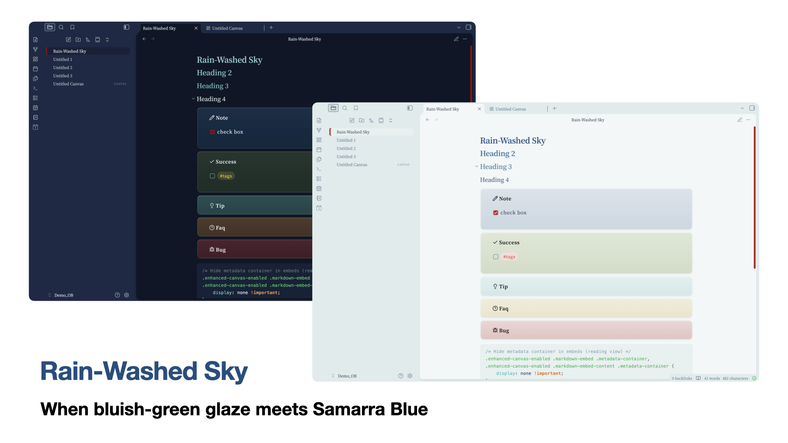

# Rain-Washed Sky - Obsidian Theme

> "The rain passes, the clouds break, and the sky is the color of the day."  
> (雨過天青雲破處，這般顏色做將來)

**Rain Washed Sky** is an Obsidian theme inspired by the timeless aesthetics of Chinese porcelain. It balances the delicate, jade-like texture of **Ru Kiln (汝窯, Ru ware)** with the deep, vivid contrast of **Blue and White porcelain (青花瓷)**.

**Language Support:** English (latin-ext), Traditional Chinese, and Simplified Chinese

---

## ✍️ Formatting Features

This theme includes specific styling tweaks to enhance writing and presenting.

### 📎 Smart Embeds (Transclusions)

By default, embedded notes (`![[Note]]`) hide the file name for a seamless reading flow. You can force the title to appear by adding a header alias:

- `![[Note Name|h1]]` → Displays title as a large H1.
- `![[Note Name|h2]]` → Displays title as a medium H2.

### 🖥️ Presentation Mode (Slides)

Optimized for the core **Slides** plugin:

- **Scrollable Slides:** Long content automatically scrolls instead of being cut off.
- **Alignment:** Text is left-aligned for better readability.
- **Scaling:** Global slide size can be adjusted via the `--slide-base-size` variable in the CSS.

### 🧱 Tactile Elements

- **3D Callouts:** Blockquotes and Callouts have a "floating" porcelain texture with rounded corners and soft shadows.
- **Mermaid Diagrams:** Constrained to page width by default; **hover** over a diagram to zoom in and scroll.
- **Typography:** Uses **Noto Serif TC** and **Noto Serif SC** with increased line height (1.8) for a book-like experience.

---

## 🎨 Color Palettes (Style Settings)

With the [Style Settings](https://github.com/obsidian-community/obsidian-style-settings) plugin installed, open **Settings** > **Style Settings** > **Rain-Washed Sky**:

- **Color palette:** Switch between **Rain-Washed Sky** (雨過天青, default), **Nordic Espresso** (北歐咖啡), **Imperial Forest** (帝王森林), **Jade & Agarwood** (翡翠沉香), and **Ink & Cinnabar** (水墨朱砂). Each palette includes both a light and a dark variant, which follow Obsidian's base color scheme.
- **Color overrides:** Fine-tune the main accent, H1–H3, bold text, links, and tag colors on top of the selected palette (separately for light and dark mode). Reset an override to fall back to the palette's color.

Without Style Settings, the theme uses the default Rain-Washed Sky palette.

---

## 🏗️ Installation

1.  Open Obsidian **Settings** > **Appearance** > **Themes**.
2.  Click **Manage**, search for **"Rain-Washed Sky"**, and install.
